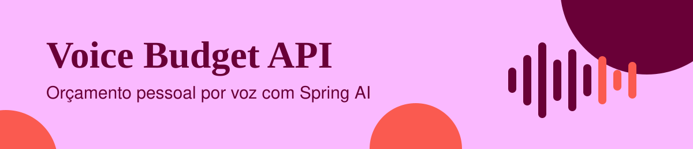
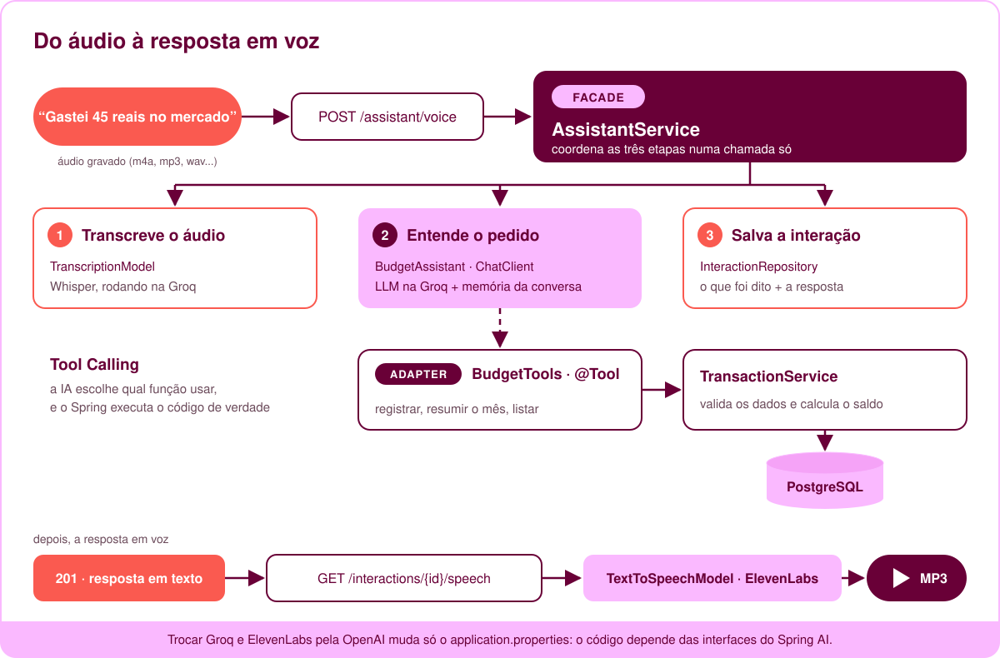

<p align="center">
  
</p>

# voice-budget-api

API de orçamento pessoal que funciona por voz: você fala o gasto, a IA entende, registra e responde em áudio. Projeto final do bootcamp CI&T · Java AI Copilot.

<p align="center">
  
  
  
  
  
</p>

<p align="center">
  
</p>

## Índice

- [O problema](#o-problema)
- [Como funciona](#como-funciona)
- [O que dá para pedir](#o-que-dá-para-pedir)
- [O que evoluí a partir do projeto base](#o-que-evoluí-a-partir-do-projeto-base)
- [Padrões de projeto](#padrões-de-projeto)
- [Decisões técnicas](#decisões-técnicas)
- [Endpoints](#endpoints)
- [Como rodar](#como-rodar)
- [Testes](#testes)
- [Estrutura](#estrutura)
- [O que aprendi](#o-que-aprendi)

<p align="center">
  
</p>

## O problema

Controlar o orçamento costuma morrer na segunda semana: abrir a planilha, escolher a categoria e digitar o valor dá trabalho justo na hora em que o gasto acontece.

Aqui basta falar. "Gastei 45 reais no mercado" vira uma despesa de alimentação com a data de hoje, e "quanto sobrou este mês?" vira o saldo, respondido em voz.

<p align="center">
  
</p>

## Como funciona

<p align="center">
  
</p>

<p align="center">
  
</p>

## O que dá para pedir

| Você fala | O que a API faz |
|---|---|
| "Gastei 45 reais no mercado" | Registra uma despesa de 45,00 em `FOOD`, com a data de hoje |
| "Recebi meu salário de 3 mil ontem" | Registra uma receita em `SALARY` com a data de ontem |
| "Quanto eu gastei este mês?" | Consulta o resumo do mês e responde com o total |
| "Quais foram meus últimos gastos?" | Lista as movimentações mais recentes |
| "Gastei no mercado" | Pergunta o valor antes de registrar, e entende a resposta seguinte |

As mesmas perguntas funcionam por texto em `POST /assistant/text`, o que ajuda a testar sem gravar áudio.

<p align="center">
  
</p>

## O que evoluí a partir do projeto base

O ponto de partida foi o projeto final da trilha de Spring da DIO, o [05-spring-ai](https://github.com/digitalinnovationone/dio-spring-boot-learning-track/blob/main/05-spring-ai/README.md): receber um áudio, transcrever, deixar a IA escolher uma função da aplicação e responder em voz. Mantive esse fluxo e montei a minha versão com estes pontos:

- **Provedores gratuitos.** No lugar da OpenAI, a transcrição e o modelo de linguagem rodam na Groq, e a voz vem da ElevenLabs. Dá para rodar o projeto inteiro sem cartão de crédito.
- **Validações antes de salvar.** Valor, data, descrição, tipo e categoria são conferidos no serviço. Nem a IA consegue gravar um valor negativo ou uma data no futuro.
- **Mais consultas para a IA.** Além de registrar, o assistente responde o resumo do mês, com saldo e gastos por categoria, e lista as últimas movimentações.
- **Respostas mais inteligentes.** O assistente sabe a data de hoje, entende "ontem" e "este mês" e lembra da conversa: se faltar o valor, ele pergunta.
- **Histórico das conversas.** Cada comando fica salvo com a mensagem, a resposta e o canal (voz ou texto). Isso serve de auditoria e permite ouvir de novo qualquer resposta.
- **Endpoints e documentação.** Rotas REST completas para as movimentações, erros padronizados no formato ProblemDetail e Swagger com todos os códigos de resposta.
- **Testes e CI.** 33 testes, incluindo integração com PostgreSQL de verdade via Testcontainers, rodando no GitHub Actions a cada push.

<p align="center">
  
</p>

## Padrões de projeto

<table>
  <tr>
    <td align="center" valign="middle"></td>
    <td valign="middle">
      <b>Onde:</b> <code>AssistantService</code>.<br><br>
      <b>Por quê:</b> responder um comando de voz envolve transcrever o áudio, conversar com a IA e salvar a interação. O controller faz uma chamada só, e a fachada coordena as etapas e traduz qualquer falha dos provedores de IA em um erro claro.
    </td>
  </tr>
  <tr>
    <td align="center" valign="middle"></td>
    <td valign="middle">
      <b>Onde:</b> <code>BudgetTools</code>.<br><br>
      <b>Por quê:</b> a IA só sabe chamar funções descritas com <code>@Tool</code>. O <code>BudgetTools</code> adapta esse formato para o <code>TransactionService</code>, que não sabe que existe IA no projeto. As regras de negócio ficam testáveis sem nenhum modelo de linguagem.
    </td>
  </tr>
  <tr>
    <td align="center" valign="middle"></td>
    <td valign="middle">
      <b>Onde:</b> <code>TranscriptionModel</code>, <code>ChatClient</code> e <code>TextToSpeechModel</code>, as interfaces do Spring AI.<br><br>
      <b>Por quê:</b> o código depende das interfaces, e a implementação concreta (Groq, ElevenLabs, OpenAI) é escolhida pela configuração. Trocar de provedor não muda nenhuma linha de Java.
    </td>
  </tr>
  <tr>
    <td align="center" valign="middle"></td>
    <td valign="middle">
      <b>Onde:</b> todos os <code>@Service</code>, <code>@Component</code> e repositórios.<br><br>
      <b>Por quê:</b> o Spring cria uma instância de cada e reaproveita. Por isso nenhum deles guarda estado de requisição, e a mesma instância atende várias pessoas ao mesmo tempo.
    </td>
  </tr>
</table>

<p align="center">
  
</p>

## Decisões técnicas

- **Provedores gratuitos no lugar da OpenAI.** A transcrição (Whisper) e o modelo de linguagem rodam na Groq, que tem uma API compatível com a da OpenAI. A voz vem da ElevenLabs, com suporte a português. Os dois têm plano gratuito sem cartão, e a troca foi feita só no `application.properties`, porque o Spring AI separa o código do fornecedor.
- **Ajustes para o plano gratuito.** O modelo da Groq raciocina antes de responder, e o Spring AI, por padrão, reenvia esse raciocínio quando a IA chama uma ferramenta. A Groq recusa esse campo, então o reenvio foi desligado (`replay-reasoning-content=false`). Na ElevenLabs, a conta gratuita só usa as vozes padrão pela API, por isso a voz configurada é uma delas. Outra voz pode ser escolhida pela variável `ELEVENLABS_VOICE_ID`.
- **Validação no serviço, não só na API.** A IA chama o `TransactionService` direto, sem passar pela validação dos controllers. Por isso valor, data e descrição também são conferidos no serviço. Quando a IA manda algo inválido, o erro volta para ela, e ela explica o problema para a pessoa em vez de quebrar a requisição.
- **Data de hoje no prompt.** O modelo não sabe que dia é. O assistente informa a data no fuso de São Paulo, e assim "ontem" e "este mês" funcionam.
- **Memória da conversa.** Se faltar o valor, o assistente pergunta, e a resposta seguinte ("foi 45 reais") é entendida no contexto. A memória fica na aplicação e reinicia junto com ela.
- **Voz sob demanda.** O áudio da resposta só é gerado quando alguém pede em `/speech`. Isso economiza os créditos do plano gratuito.
- **IA fora da transação do banco.** As chamadas aos provedores acontecem antes de abrir qualquer transação, então uma resposta lenta da IA não prende conexão do PostgreSQL.
- **Banco versionado.** O esquema é criado pelo Flyway, e não pelo Hibernate. O Docker Compose sobe o PostgreSQL sozinho quando a aplicação inicia, e os testes usam Testcontainers com um PostgreSQL de verdade.
- **Chaves fora do Git.** As chaves ficam num arquivo `.env`, que está no `.gitignore`. O repositório traz só o `.env.example`.

<p align="center">
  
</p>

## Endpoints

| Método | Rota | O que faz |
|---|---|---|
| `POST` | `/assistant/voice` | Recebe um áudio, transcreve e responde |
| `POST` | `/assistant/text` | Mesmo comando, por texto |
| `GET` | `/assistant/interactions` | Histórico das conversas |
| `GET` | `/assistant/interactions/{id}` | Uma interação |
| `GET` | `/assistant/interactions/{id}/speech` | A resposta em MP3 |
| `POST` | `/transactions` | Registra uma receita ou despesa |
| `GET` | `/transactions?month=2026-11` | Movimentações do mês |
| `GET` | `/transactions/summary?month=2026-11` | Receitas, despesas, saldo e gastos por categoria |
| `GET` | `/transactions/{id}` | Uma movimentação |
| `DELETE` | `/transactions/{id}` | Apaga uma movimentação registrada por engano |

<p align="center">
  
</p>

## Como rodar

Precisa do JDK 21 ou mais novo, do Docker Desktop aberto e de duas chaves gratuitas: uma da [Groq](https://console.groq.com/keys) e uma da [ElevenLabs](https://elevenlabs.io/app/developers/api-keys). O Maven não precisa estar instalado.

 **Clone o repositório e entre na pasta**

```bash
git clone https://github.com/Paula-Thamyres/voice-budget-api.git
cd voice-budget-api
```

 **Crie o arquivo `.env` com as chaves**

Copie o `.env.example` para `.env` e troque os textos de exemplo pelas suas chaves.

 **Suba a aplicação**

```bash
./mvnw spring-boot:run
```

No Windows (PowerShell), use `.\mvnw.cmd spring-boot:run`. O PostgreSQL sobe sozinho pelo Docker.

 **Abra o Swagger**

```
http://localhost:8080/swagger-ui.html
```

 **Teste o fluxo principal**

1. Em `POST /assistant/text`, envie `{"message": "Gastei 35 reais no almoço hoje"}`. A resposta confirma a despesa.
2. Em `GET /transactions`, a despesa aparece salva no banco, na categoria `FOOD`.
3. Grave um áudio curto no celular ou no Gravador de Som do Windows, falando um gasto, e envie em `POST /assistant/voice`.
4. Use o `id` da resposta em `GET /assistant/interactions/{id}/speech` para ouvir a resposta em MP3.

<p align="center">
  
</p>

## Testes

```bash
./mvnw test
```

No Windows (PowerShell), use `.\mvnw.cmd test`. O Docker precisa estar aberto, porque os testes de integração sobem um PostgreSQL de verdade. Nenhum teste chama os provedores de IA: eles são simulados, então os testes não gastam créditos nem dependem de internet.

| O que é testado | Como |
|---|---|
| Regras das movimentações: valor, data, arredondamento e resumo do mês | `TransactionServiceTest` |
| Ferramentas que a IA usa | `BudgetToolsTest` |
| Data de hoje no prompt e memória da conversa | `BudgetAssistantTest`, com um modelo falso |
| Fachada: áudio vazio, formato errado, áudio sem fala e falha do provedor | `AssistantServiceTest` |
| API de movimentações com PostgreSQL | `TransactionApiIntegrationTest`, com Testcontainers |
| API do assistente: voz, texto, MP3, `404`, `422` e `502` | `AssistantApiIntegrationTest`, com Testcontainers |
| Documentação do Swagger com os códigos que a API devolve | `ApiDocumentationIntegrationTest` |

<p align="center">
  
</p>

## Estrutura

```
src/main/java/com/paulathamyres/voicebudget
├── assistant/     voz, texto, IA (Facade e Adapter) e histórico das conversas
├── config/        fuso horário, relógio e Swagger
├── shared/        exceções e tratamento global de erros
└── transaction/   receitas, despesas e resumo do mês
```

**Tecnologias:** Java 21, Spring Boot 4.1, Spring AI 2.0 (ChatClient, Tool Calling, Transcription e Text-to-Speech), Groq, ElevenLabs, PostgreSQL, Flyway, Docker Compose, Testcontainers, springdoc-openapi, JUnit, Mockito e GitHub Actions.

<p align="center">
  
</p>

## O que aprendi

- **Integrar IA é mais sobre fronteiras do que sobre o modelo.** A IA chama o mesmo serviço que a API REST, então as regras de negócio valem para os dois, e trocar de fornecedor foi só configuração.
- **Plano gratuito tem regras próprias.** A Groq recusou o raciocínio que o Spring AI reenvia junto da conversa, e a ElevenLabs só libera as vozes padrão pela API. Os dois erros só ficaram claros lendo o log com calma.
- **Variável de ambiente do sistema vale mais que o `.env`.** Uma chave antiga esquecida no Windows passou por cima da nova e fez a API receber `401`.
- **Conflito de dependências aparece em tempo de execução.** O Swagger quebrou porque uma biblioteca trazia uma versão antiga das anotações dele, e o `dependency:tree` do Maven mostrou de onde ela vinha.
- **Testar com banco de verdade dá mais segurança.** Com Testcontainers os testes usam um PostgreSQL real, e simular só a IA deixa os testes rápidos e sem custo.

<p align="center">
  
</p>

Desenvolvido com apoio de IA generativa (Claude), como propõe o bootcamp.

<p align="center">
  
</p>
